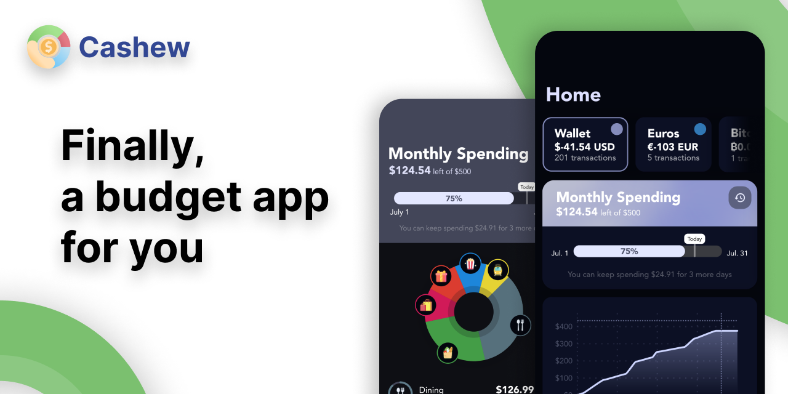
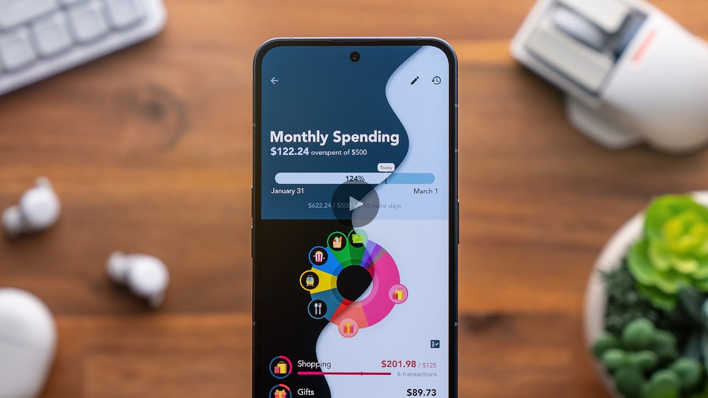
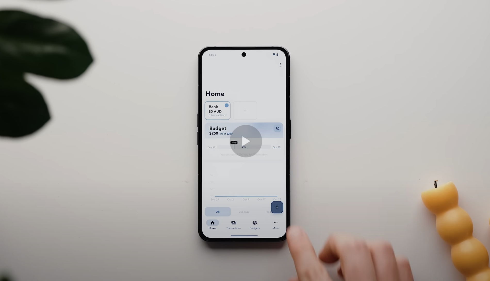
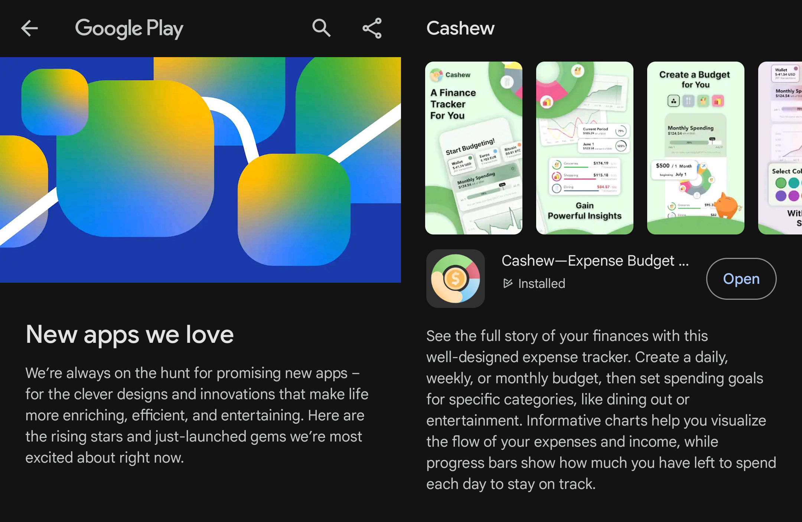
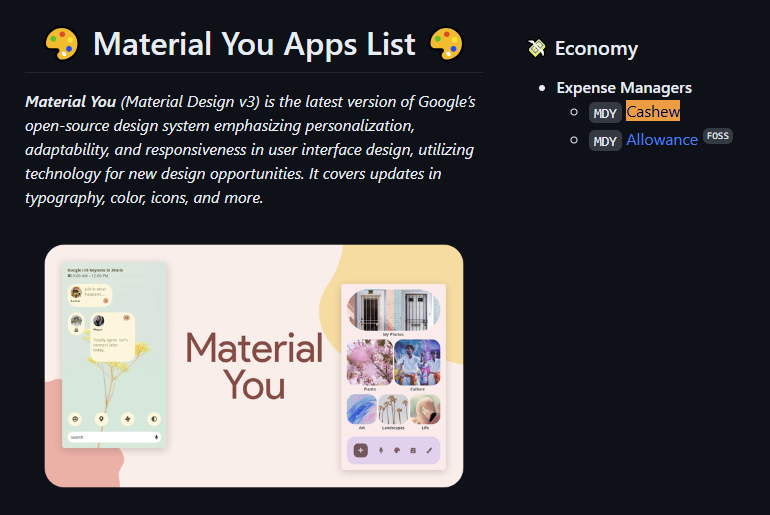

<h1 align="center" style="font-size:28px; line-height:1"><b>Cashew</b></h1>

  

 

  
  
  
  

<h3 align="center" style="font-size:28px; line-height:1">
  <a href="https://github.com/jameskokoska/Cashew/issues/725">🚀 Cashew Beta Testing</a>
</h3>

---

 

<a href="https://cashewapp.web.app/">
  

    
  

</a>

 

Cashew is a full-fledged, feature-rich application designed to empower users in managing their finances effectively. Built using Flutter - with Drift's SQL package, and Firebase - this app offers a seamless and intuitive user experience across various devices. Development started in September 2021.

---

## 📩 This fork: automatic transactions from bank SMS (India)

This is a fork of [jameskokoska/Cashew](https://github.com/jameskokoska/Cashew) that adds **automatic transactions from bank SMS** on Android, built for Indian banks and UPI. Everything else in Cashew works as before.

### ⬇️ Download

Get the latest APK from **[Releases](https://github.com/SKVhacks/Cashew/releases)**. Install `app-arm64-v8a-release.apk` (works on almost every modern Android phone; `armeabi-v7a` is for very old phones).

> **Switching from the Play Store version?** Export a backup in Cashew first, uninstall the Play Store app, install this APK, then restore the backup. The two versions are signed with different keys, so Android won't install one over the other.

### ✨ Features

- **Reads bank SMS and adds transactions automatically.** New SMS are added instantly while Cashew is open; anything that arrived while it was closed is added when you open it.
- **Debits, credits, UPI, cards, ATM, IMPS/NEFT/RTGS and autopay.** Picks up the amount, who you paid or who paid you, the account or card number, the UPI/UTR reference and the balance.
- **Autopay tagging.** NACH, e-mandate and UPI autopay debits are added as "Autopay: Netflix" and so on.
- **Skips what isn't a real transaction.** OTPs, offers, failed payments, collect requests, "will be debited" reminders, mandate set-up/revoke messages and card bill reminders are ignored. SMS from personal phone numbers are ignored too.
- **Never adds a payment twice.** Each payment is matched by its UPI/UTR reference (or the SMS text).
- **All major Indian banks.** About 60 banks and card issuers are recognised by name and SMS sender code, including SBI, HDFC, ICICI, Axis, Kotak, PNB, Bank of Baroda, Canara, Union Bank, Indian Bank, IOB, City Union Bank, KVB, TMB, Federal, South Indian Bank, IDFC First, Yes Bank, IndusInd, AU and other small finance banks, payments banks (Airtel, India Post, Paytm, Jio, Fino), and cards such as SBI Card, OneCard and Amex.
- **Bank-wise accounts.** Every bank account and card gets its own Cashew account. An existing account named after the bank (e.g. "City Union Bank") is used; otherwise one is created, like `SBI ••1234` or `HDFC Card ••5678`. The same last digits at two different banks are never mixed up.
- **Matches your bank balance.** When an SMS shows your balance (including missed-call balance alerts), Cashew adds a "Balance matched to bank" entry so the account equals the bank's figure.
- **Notifications.** A notification for each transaction added, for example: **₹500 paid to Swiggy** · *City Union Bank ••0232 · Balance ₹5,541.94*. More than 5 at once are grouped into one summary.
- **Smart categories.** Once you've used a merchant name (e.g. "Swiggy") under a category, future SMS from that merchant use the same category. Otherwise your chosen default expense and income categories are used.
- **Import old SMS.** Pick a date range to bring in past transactions; ones already added are skipped.

### ⚙️ Setup

1. Open **Settings → SMS Transactions** and turn on **Add transactions from SMS**.
2. Allow SMS access (and notifications) when Android asks.
3. Optional: choose default categories, tap a bank account to change which Cashew account it uses, or use **Import old bank SMS**.

Switches on the same page: **Notify me**, **Separate account for each bank**, and **Match bank balance**.

### 🔒 Privacy

SMS are read and processed only on your phone. Nothing is uploaded anywhere by this feature.

### ⚠️ Limitations

- Android only (iOS doesn't allow apps to read SMS).
- Not available on the Play Store: Google only allows SMS permission for default SMS apps, so this build is installed as an APK.
- Google sign-in, sync and Google Drive backup from the original app don't work in this build, because they are tied to the original developer's Firebase project. Local backup and restore work.
- If Cashew is fully closed when an SMS arrives, the transaction is added the next time you open the app.

### 🛠️ How it's built

| File | What it does |
| --- | --- |
| `budget/lib/struct/bankSmsParser.dart` | Parses Indian bank / UPI SMS (pure Dart, unit tested) |
| `budget/lib/struct/smsTransactions.dart` | Reads the inbox, listens for new SMS, adds transactions, bank-wise accounts, balance matching, notifications |
| `budget/lib/pages/smsTransactionsPage.dart` | The SMS Transactions settings page |
| `budget/android/.../MainActivity.kt` | Android SMS permission, inbox reading and live SMS listener |
| `budget/test/bank_sms_parser_test.dart` | Tests with sample SMS from many banks |
| `.github/workflows/build-apk.yml` | Tests the parser and builds a signed APK on every push |

**Building:** pushes to `main` build automatically, or run **Actions → Build APK → Run workflow**. The APK is published under Releases. Add a repository secret `CASHEW_KEYSTORE` (base64 of a keystore) so every build is signed with the same key and installs as an update.

To build locally: install Flutter 3.19.6, then run `cd budget && flutter test test/bank_sms_parser_test.dart && flutter build apk --release`.

**Found an SMS that isn't picked up?** Open an issue with the SMS text (hide your account number and name) so a sample can be added to the tests.

### 📜 Credits and license

Cashew is created by [James Kokoska](https://github.com/jameskokoska). This fork keeps the original [GPL-3.0 license](LICENSE); the SMS features are released under the same license.

---

## Features

<a href="https://www.youtube.com/watch?v=Oar9pkc7BSc&t=235s">
  

    
  

</a>

  Cashew was featured on <a href="https://www.youtube.com/watch?v=Oar9pkc7BSc&t=235s">YouTube</a> on 'The Best Free and Open Source Apps in 2024!' (and in the thumbnail!)

 

<a href="https://www.youtube.com/watch?v=NYZd7IKn1oY&t=536s">
  

    
  

</a>

  Cashew was featured on <a href="https://www.youtube.com/watch?v=NYZd7IKn1oY&t=536s">YouTube</a> on 'The Best Apps of 2023!'

 

<a href="https://www.youtube.com/watch?v=2MwWmqcn--s&t=261s">
  

    
  

</a>

  Cashew was featured on <a href="https://www.youtube.com/watch?v=2MwWmqcn--s&t=261s">YouTube</a> on 'Top Android Apps! (November 2023)'

 

  

  Cashew was featured on <a href="https://play.google.com/store/apps/editorial?id=mc_apps_new_on_play_fcp">Google Play's Editorial 'New Apps We Love'</a> (November 2023)!

 

<a href="https://github.com/nyas1/Material-You-app-list?tab=readme-ov-file#-economy:~:text=MDY%20Celenganku-,MDY%20Cashew,-MDY%20Allowance%20FOSS">
  

    
  

</a>

  Cashew was featured in the <a href="https://github.com/nyas1/Material-You-app-list?tab=readme-ov-file#-economy:~:text=MDY%20Celenganku-,MDY%20Cashew,-MDY%20Allowance%20FOSS">Material You Apps List</a>!

## Release

Check out the [official website](https://cashewapp.web.app/)!

This application is available on the [App Store](https://apps.apple.com/us/app/cashew-expense-budget-tracker/id6463662930), [Google Play](https://play.google.com/store/apps/details?id=com.budget.tracker_app), [GitHub](https://github.com/jameskokoska/Cashew/releases/) and as a [Web App (PWA)](https://budget-track.web.app/).

### Changelog

Changes and progress about development is all heavily documented in GitHub [commits](https://github.com/jameskokoska/Cashew/commits/main) and in the [changelog](https://github.com/jameskokoska/Cashew/blob/main/budget/lib/widgets/showChangelog.dart)

## Key Features

### 💸 Budget Management

- Custom Budgets and Time Periods: Set up personalized budgets with flexible time periods, such as monthly, weekly, daily, or any custom time period that suits your financial planning needs. A custom time period is useful if you plan on setting a one-time travel budget!
- Added Budgets: Selectively add transactions to specific budgets, allowing you to focus on specific expense categories.
- Category Spending Limits per Budget: Set limits for each category within a budget, ensuring responsible spending.
- Past Budget History Viewing: Analyze your spending habits over time by accessing past budget history, enabling comparison and tracking of financial progress.
- Goals: Create spending and saving goals and put transactions towards different purchases or savings. Track your progress towards achieving your financial goals.

### 💰 Transaction Management

- Support for Different Transaction Types: Categorize transactions effectively based on types such as upcoming, subscription, repeating, debts (borrowed), and credit (lent). Each type behaves in certain ways in the interface. Pay your upcoming transactions when you're ready, or mark your lent out transactions as collected.
- Custom Categories: Create personalized categories to organize transactions according to your unique spending habits. Search through multiple icons and select the default option as expenses or income when adding transactions.
- Custom Titles: Automatically assign transactions with the same name to specific categories, saving time and ensuring consistency. These titles are stored in memory and popup when you add another transaction with a similar name.
- Search and Filters: Easily search and filter transactions based on various criteria such as date, category, amount, or custom tags, enabling quick access to information.
- Easy Editing: Long-press and swipe to select multiple budgets, edit accordingly as needed or delete multiple at once.

### 💱 Financial Flexibility

- Multiple Currencies and Accounts: Manage finances across different currencies and accounts with up-to-date conversion rates for accurate calculations and effortless currency conversions. The interface shows the original amount added and the converted amount to the selected account.
- Switch Accounts and Currencies with Ease: On the homepage, easily select a different account and currency and everything will be converted automatically in an instant.

### 🔒 Enhanced Security and Accessibility

- Biometric Lock: Secure budget data using biometric authentication, adding an extra layer of privacy.
- Google Login: Conveniently log in to the app using your Google account, ensuring a streamlined and hassle-free authentication process.

### 🎨 User Experience and Design

- Material You Design: Enjoy a visually appealing and modern interface, following the principles of Material You design for a delightful user experience.
- Custom Accent Color: Personalize the app by selecting a custom accent color that suits your style, or follow that of the system.
- Light and Dark Mode: Seamlessly switch between light and dark themes to optimize visibility and reduce eye strain.
- Customizable Home Screen: Tailor the home screen layout and widgets to display the financial information that matters most to you, providing a personalized and efficient dashboard.
- Detailed Graph Visuals: Gain valuable insights into spending patterns through detailed and interactive graphs, visualizing financial data at a glance.
- Beautiful Adaptive UI: A responsive user interface that adapts flawlessly to both web and mobile platforms, providing an immersive and consistent user experience across devices.

### ☁ Backup and Syncing

- Cross-Device Sync: Keep budget data synchronized across all devices, ensuring access to financial information wherever you go.
- Google Drive Backup: Safeguard budget data by utilizing Google Drive's backup functionality, allowing easy restoration of data if needed.

### 💿 Smart Automation

- Notifications: Stay informed about important financial events and receive timely reminders for budget goals, transactions, and upcoming due dates.
- Import CSV Files: Seamlessly import financial data by uploading CSV files, facilitating a smooth transition from other applications or platforms.
- Import Google Sheets: Seamlessly import Google Sheets tables, quickly importing many transactions from a spreadsheet.
- App Links: Automatically create transactions with pre-filled data using app linking (documentation below)
- Bank SMS (this fork, Android): Automatically add transactions from Indian bank and UPI SMS, with bank-wise accounts, balance matching and notifications (see above)

## Automation

See the `Automation` section on the FAQ website for information on how to add transactions automatically: https://cashewapp.web.app/faq.html#automation

## Bundled Packages

This repository contains, bundled in, modified versions of the discontinued packages listed below. They can be found in the folder `/budget/packages`

- https://pub.dev/packages/implicitly_animated_reorderable_list
- https://pub.dev/packages/sliding_sheet

## Translations

The translations are available here: https://docs.google.com/spreadsheets/d/1QQqt28cmrby6JqxLm-oxUXCuM3alniLJ6IRhcPJDOtk/edit?usp=sharing. If you would like to help translate, please reach out on email: dapperappdeveloper@gmail.com

### To Update Translations

1. Run `budget\assets\translations\generate-translations.py`
2. Restart the application

## Developer Notes

### Pull Requests and Contributions

Unfortunately, I am currently not accepting contributions due to licensing and credits. Since this application turns some profits, I want to avoid any muddy water when it comes to compensation for contributions. You are free to submit an [issue](https://github.com/jameskokoska/Cashew/issues) and I can consider it!

### Android Release

- To build an app-bundle Android release, run `flutter build appbundle --release`

Note: required Android SDK.

### iOS Release

- To build an IPA iOS release, run `flutter build ipa`

Note: requires MacOS.

### Firebase Deployment

- To deploy to firebase, run `firebase deploy`

Note: required Firebase.

### GitHub release

- Create a tag for the current version specified in `pubspec.yaml`
- `git tag <version>`
- Push the tag
- `git push origin <version>`
- Create the release and upload binaries
- https://github.com/jameskokoska/Cashew/releases/new

### Scripts

`deploy_and_build_windows.bat`

- Deploy to Firebase and build the apk and appbundle

`open_release_builds.bat`

- Opens the location of the built apk and appbundle

`update_translations.bat`

- Downloads the latest version of Cashew translations. Runs `budget\assets\translations\generate-translations.py`

### Develop Wirelessly on Android

- `adb tcpip 5555`
- `adb connect <IP>`
- Get the phone's IP by going to `About Phone` > `Status Information` > `IP Address`

### Migrate Database

1. Make any database changes to the schema and tables
2. Bump the schema version
   - Change `int schemaVersionGlobal = ...+1` in `tables.dart`
3. Make sure you are in application root directory
   - `cd .\budget\`
4. Generate database code
   - Run `dart run build_runner build`
5. Export the new schema
   - Generate schema dump for the newly created schema
   - Replace `[schemaVersion]` in the command below with the value of `schemaVersionGlobal`
   - Run `dart run drift_dev schema dump lib\database\tables.dart drift_schemas//drift_schema_v[schemaVersion].json`
   - Read more: https://drift.simonbinder.eu/docs/advanced-features/migrations/#exporting-the-schema
6. Generate step-by-step migrations
   - Run `dart run drift_dev schema steps drift_schemas/ lib\database\schema_versions.dart`
7. Implement migration strategy
   - Edit `await stepByStep(...)` function in `tables.dart` and add the migration strategy for the new version migration

### Get Platform

- Use `getPlatform()` from `functions.dart`
- Since `Platform` is not supported on web, we must create a wrapper and always use this to determine the current platform

### Push Route

- If we want to navigate to a new page, stick to `pushRoute(context, page)` function from `functions.dart`
- It handles the platform routing and `PageRouteBuilder`

### Wallets vs. Accounts

- `Wallets` have been been renamed to `Accounts` on the front-end but internally, the name `Wallet` is still used.

### Objectives vs. Goals

- `Objectives` have been been renamed to `Goals` on the front-end but internally, the name `Objectives` is still used.

### Long Term Loans

- Long term loans create a goal. However, the goals total is not used. Instead the total of the goal is calculated by totalling the proper polarity of transactions of the opposite type. For example, if it was a loan of 100$ lent out, the initial transaction would be 100$ of negative polarity (expense) and that would be the total of the goal. When a payment is made, it is made in the opposite (positive) polarity (income) and added to the total 'paid back'. We can easily find how much is remaining by taking the difference (or the addition including polarities).
